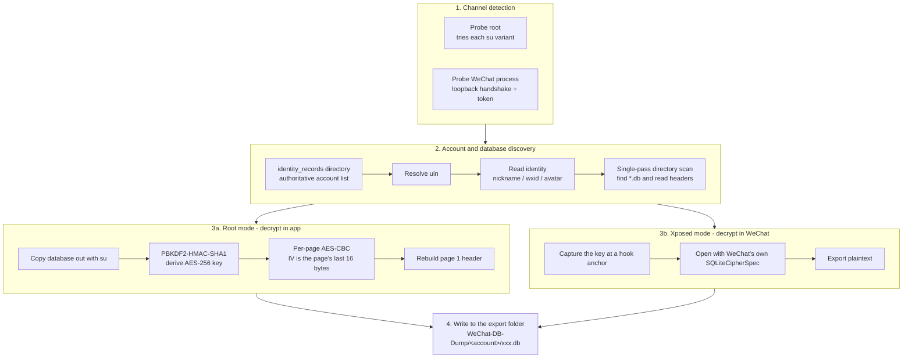

# WXDB-Dump-Android

> Android WeChat database dump tool · 安卓微信数据库明文导出工具

[](https://github.com/RYF5584/WXDBDump-Android/releases)
[](https://github.com/RYF5584/WXDBDump-Android/releases)
[](https://github.com/RYF5584/WXDBDump-Android/actions/workflows/build.yml)
[](https://github.com/RYF5584/WXDBDump-Android/stargazers)
[](LICENSE)
[](https://developer.android.com)
[](https://github.com/HighCapable/YukiHookAPI)

[中文](README.md) | **English**

Dump WeChat's encrypted Android databases to **SQLite** through **root or Xposed**.

Two independent extraction paths: **Root mode** (derives the key offline and decrypts inside the app) and **Xposed mode** (reuses WeChat's own SQLCipher).

> For research and personal data backup only. Do not use it for anything unlawful.

---

## Features

- **Both modes produce identical results** — same account discovery, identity parsing and database classification; only the key source differs
- **Root mode does not need WeChat running** — the key is derived offline from the device id and the account uin
- **Xposed mode makes no parameter guesses** — it reads WeChat's own `SQLiteCipherSpec` instead of hardcoding assumptions
- **Enumerated from the filesystem** — the account directory is scanned for `*.db`, so databases WeChat adds later show up without a code change
- **Most databases carry a description** — the common ones (chat, moments, payments, indexes) do; anything new falls back to keyword matching on the name
- **Multiple accounts** — historical accounts show their nickname, wxid and avatar too; each exports to its own folder
- **Searchable and selectable** — filter by name or purpose, or export everything at once

---

## How it works



### Where the key comes from

The derivation WeChat uses is public and fixed:

```
key = md5hex(K + uin)[:7]      # first 7 characters of the MD5 hex string
K   = RC4-decrypt files/KeyInfo.bin (RC4 key is the constant _wEcHAT_)
```

`K` is **per device**, shared by every account on it. Knowing the uin is therefore enough to derive the key offline — which is why root mode needs neither a login nor a running WeChat.

The uin is read from `default_uin` in `system_config_prefs.xml` first, then from the account's own MMKV store.

### Cipher parameters

| Parameter | Value |
|---|---|
| Key derivation | PBKDF2-HMAC-SHA1, 4000 iterations, 32 bytes |
| Cipher | AES-256-CBC |
| Page size | 1024 (detected, not assumed) |
| Per-page IV | the page's **last 16 bytes** |
| Reserved | 16 bytes |

Root mode depends on **no SQLCipher or WCDB binary**, only `javax.crypto`; see [`SqlCipherPages.java`](payload/src/main/java/io/github/ryf5584/wxdbdump/payload/crypto/SqlCipherPages.java). The page size is chosen by trial decryption, scored by how many pages come out as valid b-tree pages.

---

## Requirements

| Item | Requirement |
|---|---|
| Android | 8.0 (API 26) or newer |
| WeChat | 8.0.x with at least one account signed in |
| Root mode | KernelSU, Magisk or SuperSU with root granted to this app |
| Xposed mode | LSPosed (the Zygisk build is fine), module enabled, **WeChat** in scope |
| Storage | On Android 11+, grant "All files access" or exports fall back to the app's private directory |
| UI language | Chinese and English, but the **database descriptions are Chinese only** and stay Chinese in the English UI |

Both modes can be available at once. With one channel the app selects it; with two, you choose.

---

## Install

Download `WXDB-Dump-Android-<version>.apk` from [Releases](https://github.com/RYF5584/WXDBDump-Android/releases) and install it.

---

## Usage

### Root mode

1. Grant root to **WXDB-Dump** in KernelSU / Magisk
2. Open the app; the home screen lists both channels with their state
3. Tap **Get started** → pick an account → tick the databases → tap **Export**

WeChat does not need to be running at any point.

### Xposed mode

1. **Enable the WXDB-Dump module** in LSPosed and set its scope to WeChat
2. Start WeChat once so the hook can inject
3. Open the app; the home screen shows the Xposed channel as active

If the home screen says WeChat is not running, tap **Open WeChat**; the hook loads as it starts.

> An account that WeChat has never opened may not have had its key captured yet — switch to it once in WeChat and it will be.

### Output layout

```
/storage/emulated/0/WeChat-DB-Dump/
└── wxid_xxxxxxxxxxxx/          # one folder per account
    ├── EnMicroMsg.db           # main: messages, contacts, conversations
    ├── FTS5IndexMicroMsg_encrypt.db
    └── ...                     # the rest
```

Everything exported is standard plaintext SQLite, readable by DB Browser for SQLite, Navicat, `sqlite3` or anything else.

Handy queries:

```sql
-- Contacts
SELECT username, nickname, remark FROM rcontact WHERE username NOT LIKE '%@%';

-- The 20 most recent messages
SELECT datetime(createTime/1000, 'unixepoch', 'localtime') AS t, talker, content
FROM message ORDER BY createTime DESC LIMIT 20;
```

---

## FAQ

<details>
<summary><b>Root shows as inactive even though I granted it</b></summary>

Reinstalling or changing the package name resets the grant. One way to tell: if the app cannot even see `/system/bin/su`, the probe reports a missing file rather than a permission denial, which means it was never granted. Allow the app in KernelSU / Magisk.
</details>

<details>
<summary><b>Xposed mode shows as inactive</b></summary>

Check, in order:

1. the module is **enabled** in LSPosed
2. **WeChat** is in its scope
3. WeChat has been restarted (the hook injects at process start)
4. use **Open WeChat** on the home screen, then tap **Retry** in the app
</details>

<details>
<summary><b>An account says its uin could not be recovered</b></summary>

The key cannot be derived for that one. Use **Xposed mode** and switch to the account once in WeChat — the module captures the key directly, no uin needed.
</details>

<details>
<summary><b>A single database fails to export</b></summary>

WeChat rebuilds a few databases (FTS5 indexes among them) constantly, so a copy taken mid-rebuild can be incomplete. They do not affect the main data, and their contents can be rebuilt from `EnMicroMsg.db`; trying again usually succeeds.
</details>

<details>
<summary><b>The export folder is empty</b></summary>

On Android 11+ without "All files access" the app falls back to its private directory:

```
/storage/emulated/0/Android/data/io.github.ryf5584.wxdbdump/files/
```

Grant the permission from the settings screen to export to a public folder.
</details>

<details>
<summary><b>Why does it need the INTERNET permission? Does it phone home?</b></summary>

No. Xposed mode talks to the module over a loopback socket, and Android counts loopback as network access, so the permission is required. The server binds to `127.0.0.1` only and never listens on an external address.

Root mode does not use that channel at all and opens no port.
</details>

---

## Author

| Channel | Contact |
|---|---|
| GitHub | [@RYF5584](https://github.com/RYF5584) |
| WeChat | `RSCompanyCEO` |
| QQ | `1043695584` |
| Telegram | [@ryf5584](https://t.me/ryf5584) |

---

## Keywords

WeChat database decrypt · WeChat DB dump · EnMicroMsg decrypt · SQLCipher page decryption ·
plaintext SQLite export · Android WeChat backup · chat history export · LSPosed module ·
Xposed module · root extraction · KernelSU · Magisk · WCDB decrypt · 微信数据库导出 ·
微信数据库解密 · 微信聊天记录备份

---

## Security

The Xposed channel's loopback server binds to `127.0.0.1` and requires a two-way HMAC
handshake before it will accept a command. `TOKEN` is a build-time constant published with
the source, however, so the handshake filters peers that have not read this repository
rather than authenticating the caller.

Prefer **root mode** if you do not trust the other apps on the device: it reads through
`su` and opens no port at all.

See [SECURITY.md](SECURITY.md) for the full threat model.

---

## License

[Apache License 2.0](LICENSE). Third-party components are listed in [NOTICE](NOTICE).
