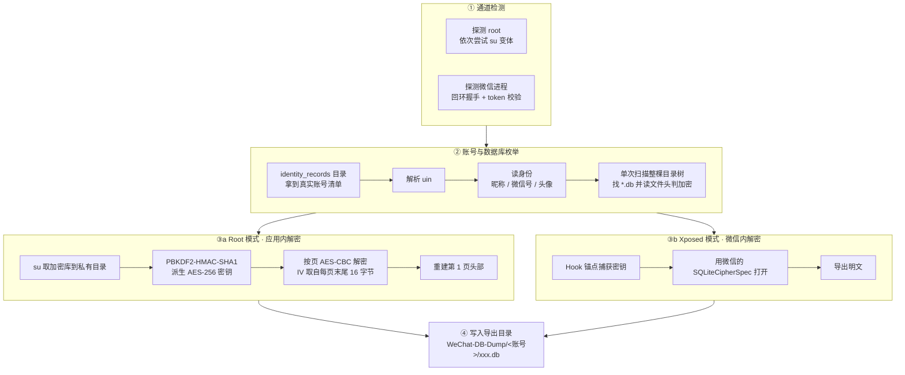

# WXDB-Dump-Android

> 安卓微信数据库明文导出工具 · An Android WeChat database dump tool

[](https://github.com/RYF5584/WXDBDump-Android/releases)
[](https://github.com/RYF5584/WXDBDump-Android/releases)
[](https://github.com/RYF5584/WXDBDump-Android/actions/workflows/build.yml)
[](https://github.com/RYF5584/WXDBDump-Android/stargazers)
[](LICENSE)
[](https://developer.android.com)
[](https://github.com/HighCapable/YukiHookAPI)

**中文** | [English](README.en.md)

通过 **Root 权限 / Xposed** 导出微信安卓加密数据库为 **SQLite** ～

支持两种互不依赖的提取方式：**Root 模式**（离线推导密钥，应用内解密）和 **Xposed 模式**（借用微信自己的 SQLCipher 解密）。

> 仅供学习研究与个人数据备份，请勿用于非法用途。

---

## 特性

- **两种模式结果一致** —— 共用同一套账号枚举、身份识别与数据库分类逻辑，只差「密钥从哪来」
- **Root 模式不需要微信运行** —— 密钥由设备标识与账号 uin 离线推导，解密在应用内完成
- **Xposed 模式参数零猜测** —— 直接读取微信自己的 `SQLiteCipherSpec`，不做硬编码假设
- **按文件系统枚举** —— 扫描账号目录找 `*.db`，微信新增的业务库会自动出现在列表里，不需要改代码
- **绝大多数库带用途说明** —— 常见库（聊天、朋友圈、支付、索引等）有中文说明，新出现的库回退到按名称关键词归类
- **多账号** —— 历史账号也能显示昵称、微信号与头像；导出按账号分目录
- **可按名称或用途搜索** —— 支持全选一键导出

---

## 工作原理



### 密钥从哪来

微信的密钥算法是公开且固定的：

```
key = md5hex(K + uin)[:7]      # 取 MD5 十六进制串的前 7 个字符
K   = files/KeyInfo.bin 经 RC4 解密（RC4 密钥为固定串 _wEcHAT_）
```

`K` 是**设备级**的，同一台设备上所有账号共用。所以只要知道 uin 就能离线算出密钥 —— 这正是 Root 模式能工作的原因：不需要登录、不需要微信在运行。

`uin` 优先从 `system_config_prefs.xml` 的 `default_uin` 读取，读不到再尝试账号级 MMKV。

### 加密参数

| 参数 | 值 |
|---|---|
| 密钥派生 | PBKDF2-HMAC-SHA1，4000 次迭代，32 字节 |
| 加密算法 | AES-256-CBC |
| 页大小 | 1024（自动判定，不写死） |
| 每页 IV | 该页**末尾 16 字节** |
| reserved | 16 字节 |

Root 模式**不依赖任何 SQLCipher / WCDB 二进制库**，全部由 `javax.crypto` 实现，见 [`SqlCipherPages.java`](payload/src/main/java/io/github/ryf5584/wxdbdump/payload/crypto/SqlCipherPages.java)。页大小按多个候选试解密，以「解出的页有多少是合法 b-tree 页」为判据自动选定。

---

## 环境要求

| 项目 | 要求 |
|---|---|
| Android | 8.0（API 26）及以上 |
| 微信 | 8.0.x，且已登录至少一个账号 |
| Root 模式 | KernelSU / Magisk / SuperSU 任一，并授予本应用 root |
| Xposed 模式 | LSPosed（Zygisk 版即可），启用本模块，作用域勾选**微信** |
| 存储权限 | Android 11+ 建议授予「所有文件访问」，否则导出会落到应用私有目录 |
| 界面语言 | 中文 / English；**数据库用途说明目前只有中文**，英文界面下这部分仍显示中文 |

两种模式可以同时可用。只检测到一条通道时会自动选中，两条都可用时由你选择。

---

## 安装

从 [Releases](https://github.com/RYF5584/WXDBDump-Android/releases) 下载 `WXDB-Dump-Android-<版本>.apk` 直接安装。

---

## 使用

### Root 模式

1. 在 KernelSU / Magisk 中给 **WXDB-Dump** 授权 root
2. 打开应用，首页显示「Root 权限 · 已激活」
3. 点「开始使用」→ 选择账号 → 勾选要导出的数据库 → 点「导出」

全程不需要微信运行。

### Xposed 模式

1. 在 LSPosed 中**启用 WXDB-Dump 模块**，作用域勾选微信
2. 启动一次微信，让 Hook 注入进程
3. 打开应用，首页显示「Xposed 模块 · 已激活」

若首页提示「微信还没运行」，点「打开微信」按钮启动它，Hook 会在微信启动后自动加载。

> 从未在微信里打开过的账号，密钥可能尚未被捕获 —— 在微信里切换一次该账号即可。

### 导出结果

```
/storage/emulated/0/WeChat-DB-Dump/
└── wxid_xxxxxxxxxxxx/          # 按账号分目录
    ├── EnMicroMsg.db           # 主库：聊天记录、联系人、会话
    ├── FTS5IndexMicroMsg_encrypt.db
    └── ...                     # 其余业务库
```

导出的都是标准明文 SQLite，用 DB Browser for SQLite、Navicat、`sqlite3` 等任意工具打开即可。

常用查询：

```sql
-- 联系人
SELECT username, nickname, remark FROM rcontact WHERE username NOT LIKE '%@%';

-- 最近 20 条聊天记录
SELECT datetime(createTime/1000, 'unixepoch', 'localtime') AS t, talker, content
FROM message ORDER BY createTime DESC LIMIT 20;
```

---

## 常见问题

<details>
<summary><b>首页显示 root 未激活，但明明授权过了</b></summary>

改包名或重装后需要重新授权。一个判断方法：如果应用连 `/system/bin/su` 都看不见，探测会报文件不存在而不是权限拒绝，这表示从未授权过。去 KernelSU / Magisk 的授权列表里给本应用放行即可。
</details>

<details>
<summary><b>Xposed 模式显示未激活</b></summary>

按顺序检查：

1. LSPosed 里模块是否已**启用**
2. 作用域是否勾选了**微信**
3. 微信是否重启过（Hook 在微信进程启动时注入）
4. 用首页的「打开微信」按钮启动微信，再回应用点「重试」
</details>

<details>
<summary><b>某个账号显示「恢复不出 uin」</b></summary>

这个账号的密钥推导不出来，改用 **Xposed 模式**，并在微信里切换到该账号一次 —— 模块会直接捕获密钥，不需要 uin。
</details>

<details>
<summary><b>个别数据库导出失败</b></summary>

微信有几类库（如 FTS5 全文索引）会被反复重建，抓取时可能拿到不完整的快照。这类库不影响主库数据，内容也能由 `EnMicroMsg.db` 重建，多试一次通常即可成功。
</details>

<details>
<summary><b>导出目录里没有文件</b></summary>

Android 11+ 未授予「所有文件访问」时会自动回退到应用私有目录：

```
/storage/emulated/0/Android/data/io.github.ryf5584.wxdbdump/files/
```

在设置页点「去授权」授予权限后即可导出到公共目录。
</details>

<details>
<summary><b>为什么要 INTERNET 权限？会联网吗？</b></summary>

不会联网。Xposed 模式靠一个回环 socket 让应用和模块通信，而回环 socket 在 Android 上也算网络，
所以必须声明 `INTERNET`。服务端只 bind 到 `127.0.0.1`，不监听任何外部地址。

Root 模式完全不用这个通道，不开任何端口。
</details>

---

## 作者

| 渠道 | 联系方式 |
|---|---|
| GitHub | [@RYF5584](https://github.com/RYF5584) |
| 微信 | `RSCompanyCEO` |
| QQ | `1043695584` |
| Telegram | [@ryf5584](https://t.me/ryf5584) |

---

## 关键词

安卓微信数据库导出 · 微信数据库解密 · 微信聊天记录导出 · 微信数据库明文导出 ·
EnMicroMsg.db 解密 · SQLCipher 解密 · WCDB 解密 · 微信 db 转 sqlite ·
微信数据库查看工具 · LSPosed 模块 · Xposed 模块 · Root 提取 · KernelSU · Magisk ·
微信数据备份 · 聊天记录备份 · 微信 forensics · WeChat database decrypt ·
WeChat DB dump · EnMicroMsg decrypt · SQLCipher page decryption · plaintext SQLite export

---

## 安全说明

Xposed 模式的回环通道只监听 `127.0.0.1`，并需要双向 HMAC 握手才能下发命令。但
`TOKEN` 是**构建期常量且随源码公开**，所以握手过滤的是「没读过本仓库的程序」，
**不等于在认证调用方**。

如果你在意同设备上其它 App 的行为，优先用 **Root 模式** —— 它走 `su`，不开任何端口。

细节与威胁模型见 [SECURITY.md](SECURITY.md)。

---

## 许可

[Apache License 2.0](LICENSE)。第三方组件见 [NOTICE](NOTICE)。
